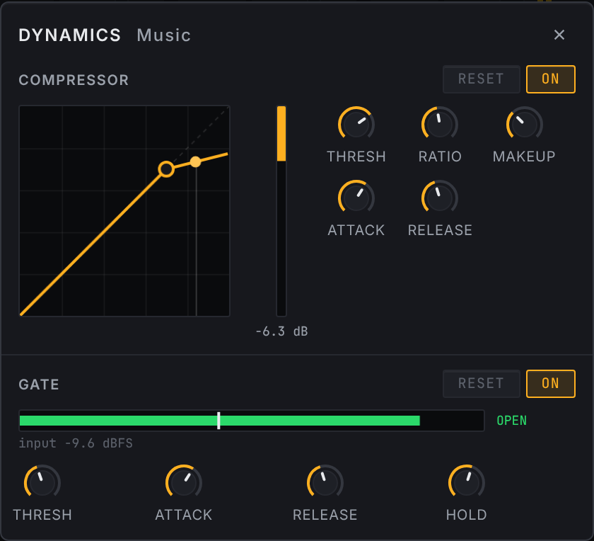
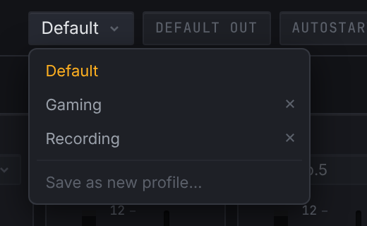
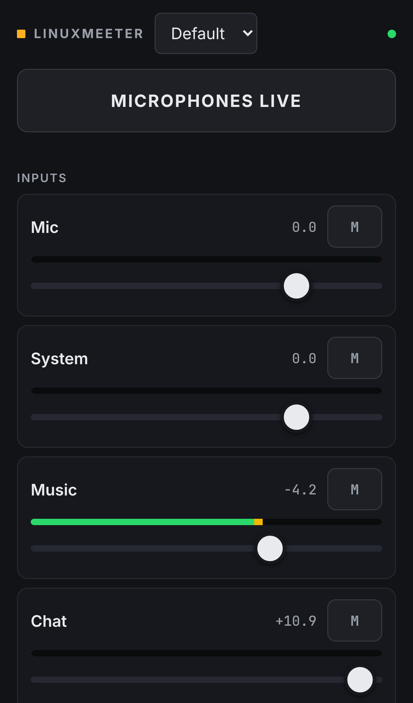

# linuxmeeter

A VoiceMeeter-style virtual audio mixer for Linux, built natively on
**PipeWire**. Route any app or microphone through gated, compressed, EQ'd
channel strips into hardware outputs and virtual microphones that Discord,
OBS, or any recorder can use.

This is a fork of [dslapelis/linuxmeeter](https://github.com/dslapelis/linuxmeeter)
with as many strips and buses as you need, renaming, profile switching, a
12-point EQ (also on the speaker and headphone outputs), gain-reduction displays, global shortcuts, a phone remote, desktop
notifications, a microphone warning tone, volume keys that follow the profile's
hardware output, a helper for crackling wireless headsets, backups, in-app updates, and packages for Arch and Debian.


## Install

Download the package for your system from the
[Releases page](https://github.com/Schnubbirunkel/linuxmeeter/releases).

**Arch Linux** — `linuxmeeter-*.pkg.tar.zst`:

```sh
sudo pacman -U linuxmeeter-*.pkg.tar.zst
```

**Debian 13 (trixie)** — `linuxmeeter_*_amd64.deb`:

```sh
sudo apt install ./linuxmeeter_*_amd64.deb
```

Both pull in what they need (PipeWire, WirePlumber, `lsp-plugins-lv2`,
WebKitGTK 4.1, GTK 3, the Ayatana tray library). Other distributions: build
from source (below).

## Features

### Mixer

- **Input strips** — hardware strips capture real devices (mic, line in);
  virtual strips appear as output devices apps can play into
  (System / Music / Chat out of the box)
- **Add and remove strips and buses** — "+" beside Hardware / Virtual /
  Buses, × in a strip's header (click twice). Up to 16 strips; buses A1–A4
  play to hardware outputs, B1–B3 are **virtual microphones** (post-limiter)
  for Discord, OBS and others
- **Rename anything** — double-click a strip or bus name. The new name is
  also what other programs show for the device (Discord, OBS, KDE's volume
  control); programs using it are moved back after the device is re-created
- **Shown in KDE's volume applet** — the virtual devices appear like sound
  cards, without "Show virtual devices"
- **Routing matrix** — one button per bus on every strip, applied as live
  PipeWire links; mute/solo; peak/RMS metering with clip latch at 30 fps
- **Default-output takeover** — one click makes the System strip your
  default sink so *all* desktop audio flows through the mixer

### Sound

- **Per-strip DSP** — gate, compressor (with transfer-curve editor), EQ and a
  VoiceMeeter-style **voice color** XY pad, all [LSP](https://lsp-plug.in)
  LV2 plugins inside PipeWire filter-chains; a limiter on every bus
- **EQ with up to 12 points** — double-click the curve to add one, double-click
  a point (or ×) to remove it, click its name to switch between peak, low/high
  shelf, low cut and high cut; drag for frequency and gain, mouse wheel for Q.
  *COPY TO…* gives another strip (or all of them) the same EQ
- **Output EQ for your speakers and headphones** — every hardware bus (A1–A4)
  has its own EQ to correct how that device sounds to you; the virtual
  microphones (what OBS or Discord get) are not affected

  

- **See what the dynamics do** — a gain-reduction bar under every bus limiter;
  in the dynamics panel the live input level moves along the compressor
  curve, next to its gain reduction, and the gate shows the level against its
  threshold and whether it is open

  

### Control

- **Profiles** — switch, save as new and delete from the menu in the top bar
  or the tray. Profiles with the same strips switch without interrupting
  audio. Everything persists to `~/.config/linuxmeeter/` (TOML,
  hand-editable)

  

- **Volume keys per profile** — choose which hardware output the keyboard's
  volume keys and a headset's volume wheel control (onboard, USB headset,
  HDMI …) or leave them with the desktop; switching profile switches the
  device. On KDE Plasma linuxmeeter borrows the keys from Plasma's volume
  control while needed (with its volume display) and gives them back on quit

- **Global shortcuts** — set keys in Settings (gear icon): mute and ±5 % per
  strip and bus, mute all microphones, next/previous profile. On KDE Plasma
  they work everywhere, also with the window hidden, and show up in System
  Settings → Shortcuts. On other desktops, bind the `linuxmeeter ctl …`
  commands Settings lists to keys in the desktop's own shortcut settings
- **Phone remote** — Settings → Phone remote, scan the QR code: your phone's
  browser controls every fader, mute, the microphones and the profile, with
  live meters. No app; only devices on your network with the code's key
  connect

  

- **Updates in the app** — Settings → Updates checks GitHub and installs the
  new version with one click (Arch and Debian; password prompt, then a
  restart). Follow the releases, or every push to main
- **Clock helper** — a device that crackles or sounds like a robot because it
  follows another device's clock (common with wireless USB headsets) is
  detected; one click lets it set the clock instead (Settings → Clock to undo)
- **Microphone warning tone** — two short notes on your speakers when the
  microphones are muted (falling) or go live (rising), however you did it;
  played straight to the hardware, never into a virtual mic (can be turned off)
- **Desktop notifications** — profile switches and shortcut actions show a
  notification even while the window is hidden (can be turned off)
- **Tray menu** — mute all microphones, switch profile, show the mixer;
  close-to-tray and optional autostart keep your devices alive from login
- **Backup** — export / import every profile and setting as one file
- **Command line** — `linuxmeeter ctl` controls the running mixer:
  `toggle-mute`, `volume-up|down <channel> [percent]`, `toggle-mute-mics`,
  `profile <name>`, `profile-next`, `rename`, `add-strip`, `add-bus`,
  `export <file>`, `import <file>`, `list` … (`linuxmeeter ctl help`)

  

- **Clean by design** — all virtual devices live in-process and vanish
  completely when the app exits; WirePlumber is never left managing our
  volumes

## Requirements

- PipeWire ≥ 1.0 with WirePlumber and filter-chain LV2 support (Arch:
  `pipewire-audio`; Debian: `libspa-0.2-modules`)
- `lsp-plugins-lv2` (gate/compressor/EQ/limiter DSP)
- `webkit2gtk-4.1`, `gtk3`, `libayatana-appindicator` (UI shell + tray)
- For in-app global shortcuts: KDE Plasma (its `kglobalaccel` service)

## Building

```sh
pnpm install
pnpm tauri dev          # development (mixer runs against your live graph)
pnpm tauri build --no-bundle   # release binary at target/release/linuxmeeter
```

Arch users: see `packaging/PKGBUILD` (git build) or `packaging/release/PKGBUILD`.

## Development notes

- `pnpm dev` in a plain browser runs the full UI against a **mock backend**
  with simulated meters — the design-iteration environment.
- The workspace splits into `lm-protocol` (shared types), `lm-engine`
  (all PipeWire code, testable headless — see `examples/`), and `src-tauri`
  (shell + IPC).
- `cargo run --example graph -p lm-engine` drives the full audio topology
  from a REPL without the UI.
- CI runs the unit tests and `make test-audio` (real PipeWire, real LSP
  plugins) in an Arch container on every push, and on Debian trixie builds
  the `.deb` (`packaging/debian/build-deb.sh`), installs it with apt and
  smoke-tests it with WirePlumber (`packaging/debian/smoke-test.sh`). A push
  to `main` with a new version in `packaging/release/PKGBUILD` publishes a
  release with both packages.

## License

GPL-3.0-or-later. Bundled fonts (Inter, JetBrains Mono) are under the SIL
Open Font License.
