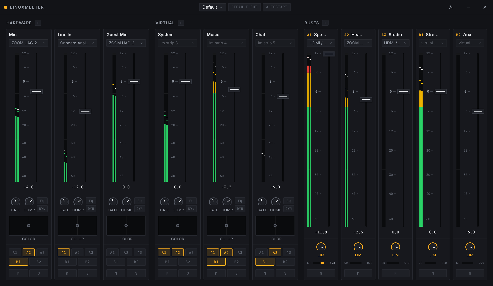
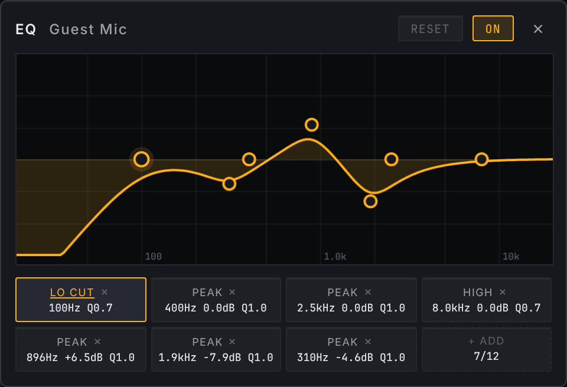
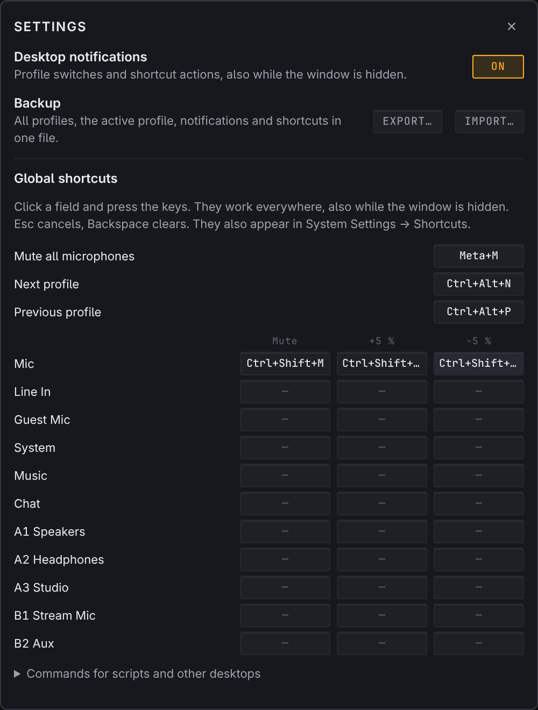

# linuxmeeter

A VoiceMeeter-style virtual audio mixer for Linux, built natively on
**PipeWire**. Route any app or microphone through gated, compressed, EQ'd
channel strips into hardware outputs and virtual microphones that Discord,
OBS, or any recorder can use.

This is a fork of [dslapelis/linuxmeeter](https://github.com/dslapelis/linuxmeeter)
with as many strips and buses as you need, renaming, profile switching, global
shortcuts, desktop notifications, a 12-point EQ, gain-reduction displays and
backups.



## Install

**Arch Linux**: download `linuxmeeter-*.pkg.tar.zst` from the
[Releases page](https://github.com/Schnubbirunkel/linuxmeeter/releases), then

```sh
sudo pacman -U linuxmeeter-*.pkg.tar.zst
```

pacman pulls in what it needs (PipeWire with `pipewire-audio`, WirePlumber,
`lsp-plugins-lv2`, `webkit2gtk-4.1`, `gtk3`, `libayatana-appindicator`).

Other distributions: build from source (below).

## Features

### Mixer

- **Input strips** — hardware strips capture real devices (mic, line in);
  virtual strips appear as output devices apps can play into
  (System / Music / Chat out of the box)
- **Add and remove strips and buses** — "+" beside Hardware / Virtual /
  Buses, × in a strip's header (click twice). Up to 16 strips; buses A1–A4
  play to hardware outputs, B1–B3 are **virtual microphones** (post-limiter)
  for Discord, OBS and others
- **Rename anything** — double-click a strip or bus name. The new name is
  also what other programs show for the device (Discord, OBS, KDE's volume
  control); programs using it are moved back after the device is re-created
- **Shown in KDE's volume applet** — the virtual devices appear like sound
  cards, without "Show virtual devices"
- **Routing matrix** — one button per bus on every strip, applied as live
  PipeWire links; mute/solo; peak/RMS metering with clip latch at 30 fps
- **Default-output takeover** — one click makes the System strip your
  default sink so *all* desktop audio flows through the mixer

### Sound

- **Per-strip DSP** — gate, compressor (with transfer-curve editor), EQ and a
  VoiceMeeter-style **voice color** XY pad, all [LSP](https://lsp-plug.in)
  LV2 plugins inside PipeWire filter-chains; a limiter on every bus
- **EQ with up to 12 points** — double-click the curve to add one, double-click
  a point (or ×) to remove it, click its name to switch between peak, low/high
  shelf, low cut and high cut; drag for frequency and gain, mouse wheel for Q

  

- **See what the dynamics do** — a gain-reduction bar under every bus limiter;
  in the dynamics panel the live input level moves along the compressor
  curve, next to its gain reduction, and the gate shows the level against its
  threshold and whether it is open

  

### Control

- **Profiles** — switch, save as new and delete from the menu in the top bar
  or the tray. Profiles with the same strips switch without interrupting
  audio. Everything persists to `~/.config/linuxmeeter/` (TOML,
  hand-editable)

  

- **Global shortcuts** — set keys in Settings (gear icon): mute and ±5 % per
  strip and bus, mute all microphones, next/previous profile. On KDE Plasma
  they work everywhere, also with the window hidden, and show up in System
  Settings → Shortcuts. On other desktops, bind the `linuxmeeter ctl …`
  commands Settings lists to keys in the desktop's own shortcut settings
- **Desktop notifications** — profile switches and shortcut actions show a
  notification even while the window is hidden (can be turned off)
- **Tray menu** — mute all microphones, switch profile, show the mixer;
  close-to-tray and optional autostart keep your devices alive from login
- **Backup** — export / import every profile and setting as one file
- **Command line** — `linuxmeeter ctl` controls the running mixer:
  `toggle-mute`, `volume-up|down <channel> [percent]`, `toggle-mute-mics`,
  `profile <name>`, `profile-next`, `rename`, `add-strip`, `add-bus`,
  `export <file>`, `import <file>`, `list` … (`linuxmeeter ctl help`)

  

- **Clean by design** — all virtual devices live in-process and vanish
  completely when the app exits; WirePlumber is never left managing our
  volumes

## Requirements

- PipeWire ≥ 1.0 with WirePlumber (on Arch also `pipewire-audio`, which holds
  the filter-chain LV2 support)
- `lsp-plugins-lv2` (gate/compressor/EQ/limiter DSP)
- `webkit2gtk-4.1`, `gtk3`, `libayatana-appindicator` (UI shell + tray)
- For in-app global shortcuts: KDE Plasma (its `kglobalaccel` service)

## Building

```sh
pnpm install
pnpm tauri dev          # development (mixer runs against your live graph)
pnpm tauri build --no-bundle   # release binary at target/release/linuxmeeter
```

Arch users: see `packaging/PKGBUILD` (git build) or `packaging/release/PKGBUILD`.

## Development notes

- `pnpm dev` in a plain browser runs the full UI against a **mock backend**
  with simulated meters — the design-iteration environment.
- The workspace splits into `lm-protocol` (shared types), `lm-engine`
  (all PipeWire code, testable headless — see `examples/`), and `src-tauri`
  (shell + IPC).
- `cargo run --example graph -p lm-engine` drives the full audio topology
  from a REPL without the UI.
- CI runs the unit tests and `make test-audio` (real PipeWire, real LSP
  plugins) in an Arch container on every push; a push to `main` with a new
  version in `packaging/release/PKGBUILD` publishes a release.

## License

GPL-3.0-or-later. Bundled fonts (Inter, JetBrains Mono) are under the SIL
Open Font License.
